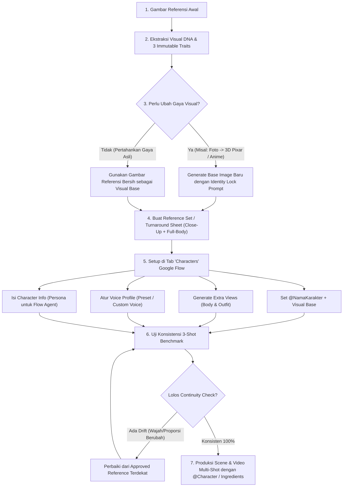

# Workflow: Membuat Karakter Konsisten dari Gambar Referensi di Google Flow

Workflow ini dirancang untuk mengubah **1 gambar referensi** (foto asli, ilustrasi, atau konsep karakter) menjadi **aset karakter yang terkunci identitasnya (*Identity-Locked Character*)** di **Google Flow**, siap digunakan berulang kali di berbagai *scene* gambar maupun video (menggunakan *Nano Banana Pro*, *Omni Flash*, dan *Veo*).

---

## Diagram Alur Kerja (Pipeline)



---

## Langkah Demi Langkah (Step-by-Step Workflow)

### Langkah 1: Persiapan & Kurasi Gambar Referensi
Sebelum mengunggah gambar ke AI atau Google Flow, pastikan gambar referensi memenuhi kriteria berikut:
- **Resolusi & Ketajaman**: Wajah terlihat jelas, tidak blur, dan tidak tertutup bayangan ekstrem.
- **Pencahayaan Netral**: Hindari lampu neon berwarna tajam pada gambar induk karena model akan menganggap warna lampu tersebut sebagai warna kulit permanen.
- **Sudut Pandang**: Tampak depan (*front-facing*) atau sedikit menyerong (*3/4 angle*) dengan mata menghadap kamera.

---

### Langkah 2: Ekstraksi "Locked Identity Block"
Jangan menulis deskripsi karakter secara acak di setiap prompt. Buat **1 blok teks standar** dengan urutan baku berikut:

```text
[Nama Karakter], [Gender & Usia], [Bentuk Wajah & Skin Tone], [Bentuk & Warna Mata], [Gaya, Panjang, & Warna Rambut], mengenakan [Pakaian Utama: warna, bahan, potongan], [Aksesori Khas], [Proporsi Tubuh]. Pertahankan mutlak: (1) [Ciri Khas 1], (2) [Ciri Khas 2], (3) [Ciri Khas 3].
```

**Contoh Nyata:**
> `Raka, pria sekitar 27 tahun, wajah oval tegas dengan kulit sawo matang hangat, mata cokelat gelap beralis tebal, rambut hitam bergelombang pendek belah samping, mengenakan jaket bomber hijau olive di atas kaos putih polos dan celana chino hitam, kacamata bingkai tipis perak, postur tegap proporsional. Pertahankan mutlak: (1) kacamata bingkai perak tipis, (2) tahi lalat kecil di bawah mata kiri, (3) jaket bomber hijau olive.`

---

### Langkah 3: Transformasi Gaya Visual (Opsional)
Jika gambar awal adalah foto manusia dan kamu ingin mengubahnya menjadi karakter animasi 3D, Anime, atau ilustrasi sebelum masuk ke Google Flow:
1. Unggah gambar referensi ke Gemini / Nano Banana Pro / Image Generator.
2. Gunakan **Identity Preservation Prompt** (lihat [references/style-transformations.md](../references/style-transformations.md)):
   ```text
   Use the uploaded photo as the ONLY identity reference. Preserve the person's facial structure, hairstyle, skin tone, eye shape, glasses/accessories, and distinctive features 100% accurately. Transform this exact person into a [Pixar-quality 3D animated character / cinematic photorealistic portrait / modern anime character] wearing [deskripsi pakaian]. Neutral studio lighting, clean solid gray background, sharp focus on face.
   ```
3. Simpan hasil terbaik sebagai **Approved Visual Base**.

---

### Langkah 4: Membuat Reference Ingredients (Portrait + Full Body Turnaround)
Agar karakter tidak berubah saat kamera bergerak jauh (*wide shot*) atau menyamping di Google Flow:
1. **Asset A — Master Close-Up Portrait**: Gambar dada ke atas (*chest-up*), pencahayaan merata, ekspresi netral atau senyum tipis.
2. **Asset B — Full-Body / Multi-Angle Sheet**: Gunakan gambar Asset A sebagai referensi gambar, lalu jalankan prompt berikut:
   ```text
   Using the attached character reference, generate a clean full-body character turnaround sheet showing front view, 3/4 view, and side profile view of the exact same character: [tempel Locked Identity Block]. Keep the exact same face, hairstyle, body proportions, and outfit across all angles. Neutral studio gray background, flat even lighting, full body from head to toe including shoes.
   ```

---

### Langkah 5: Registrasi Karakter di Tab `Characters` Google Flow
Masuk ke studio **Google Flow** (`flow.google.com`) dan ikuti tahapan ini:

1. **Buka Tab `Characters` -> Klik `New Character`**:
   - Beri nama panggilan pendek tanpa spasi (misal: `Raka` sehingga bisa dipanggil dengan `@Raka`).
   - Unggah atau pilih **Approved Visual Base** (Asset A).
2. **Tambahkan `Extra Views` (Sudut Pandang Tambahan)**:
   - Klik opsi pembuatan referensi kedua (*second reference image*).
   - Masukkan deskripsi tubuh & pakaian secara spesifik pada kolom yang diminta Flow:
     > *"Postur tegap proporsional, mengenakan jaket bomber hijau olive dengan resleting perak di atas kaos crew-neck putih polos, celana chino hitam slim-fit, dan sepatu sneakers kulit putih bersih."*
3. **Konfigurasi `Voice` (Profil Suara)**:
   - Pilih **Preset Voice** yang cocok, atau buat **Custom Voice**:
     - Pilih *Base Voice*.
     - Tulis deskripsi suara dalam bahasa Inggris agar akurasi sintesis maksimal:
       > *"Warm mid-low baritone voice, calm and natural conversational pace, clear articulation with a friendly, slightly confident tone."*
4. **Isi `Character Info` (Memori untuk Google Flow Agent)**:
   - Kolom ini dibaca langsung oleh **Google Flow Agent** saat membuat skrip dan mengarahkan adegan:
     > *"Raka adalah desainer produk yang tenang, observan, dan punya selera humor kering. Saat berbicara ia sering mengangguk pelan dan tersenyum tipis. Gerakan tubuhnya rileks dan tidak terburu-buru."*

---

### Langkah 6: Memilih Mode Referensi di Google Flow
Sesuaikan mode referensi dengan kebutuhan *project* kamu:

| Mode di Google Flow | Kapan Digunakan | Cara Pakai |
| :--- | :--- | :--- |
| **`@Tags` Mode** (`@NamaKarakter` / `@me`) | Saat membuat berbagai adegan cerita dengan satu atau beberapa karakter yang sudah disimpan di tab *Characters*. | Ketik `@Raka` langsung di dalam kalimat prompt adegan. |
| **`Ingredients` Mode** | Saat ingin memaksa semua generasi prompt menggunakan satu paket gambar referensi yang sama (misal: 1 portrait + 1 full-body + 1 objek). | Pilih gambar referensi di panel *Ingredients*, lalu jalankan rangkaian prompt untuk *shot group* yang berdekatan. |
| **`Whisk` Mode** | Saat ingin menggabungkan referensi berdasarkan kategori terpisah: **Subject** (Karakter) + **Scene** (Lokasi) + **Style** (Gaya Visual). | Masukkan gambar karakter ke slot *Subject*, gambar latar ke *Scene*, dan referensi warna/visual ke *Style*. |

---

### Langkah 7: Uji Konsistensi 3-Shot Benchmark (Sebelum Produksi Panjang)
Jangan langsung men-generate puluhan video! Jalankan **3-Shot Continuity Test** terlebih dahulu menggunakan satu prompt identitas yang sama:

1. **Test 1 — Face Close-Up & Micro-Expression**:
   > `@Raka [Locked Identity Block]. Medium close-up shot looking slightly toward the camera, smiling warmly and nodding subtly. Soft natural window light, shallow depth of field, 85mm lens.`
2. **Test 2 — Full-Body di Lokasi Baru**:
   > `@Raka [Locked Identity Block]. Full-body wide shot standing inside a modern minimalist coffee shop, holding a ceramic mug. Warm morning sunlight streaming through glass windows, 35mm cinematic lens.`
3. **Test 3 — Action & Pergerakan Kamera (Image-to-Video / Veo)**:
   > `@Raka [Locked Identity Block]. Medium tracking shot as he walks slowly along a rain-dampened city sidewalk in the afternoon, looking around calmly. Smooth gimbal camera movement, natural ambient lighting.`

**Evaluasi Skor Konsistensi:**
- Apakah bentuk wajah & mata tetap sama?
- Apakah gaya & belahan rambut tidak bergeser?
- Apakah warna dan detail pakaian tetap utuh?
- Apakah proporsi tubuh stabil saat bergerak?

---

### Langkah 8: Produksi Video & Lip-Sync (Veo / Google Flow)
Saat mengubah *still image* yang sudah disetujui menjadi video atau dialog:
- **Gunakan Stills yang Sudah Disetujui (*Approved Frame*)**: Selalu jadikan gambar hasil *shot* terbaik sebagai *starting frame* / *ingredient* untuk video Veo.
- **Ubah Satu Variabel per Generasi**: Jangan mengubah referensi, pencahayaan, pakaian, dan lokasi secara bersamaan dalam satu lompatan.
- **Jaga Aksi Tetap Sederhana**: Untuk menjaga stabilitas wajah di Veo, hindari menumpuk terlalu banyak gerakan akrobatik dalam satu klip 5-8 detik. Gunakan deskripsi aksi yang jelas dan berurutan.
- **Prompt Dialog & Lip-Sync**:
  ```text
  Use @Raka as the reference character. Medium close-up shot at eye level. @Raka looks directly into the camera with a calm, warm expression and naturally speaks the following dialogue with realistic facial expressions and accurate lip synchronization: "[Teks Dialog]"
  ```
- **Gunakan Sesi Baru untuk Adegan Berbeda**: Jika berpindah latar secara drastis (misal dari studio ke jalanan hujan), mulai sesi baru dengan memanggil kembali `@Karakter` dan *character sheet* close-up agar memori konteks visual tetap bersih.
